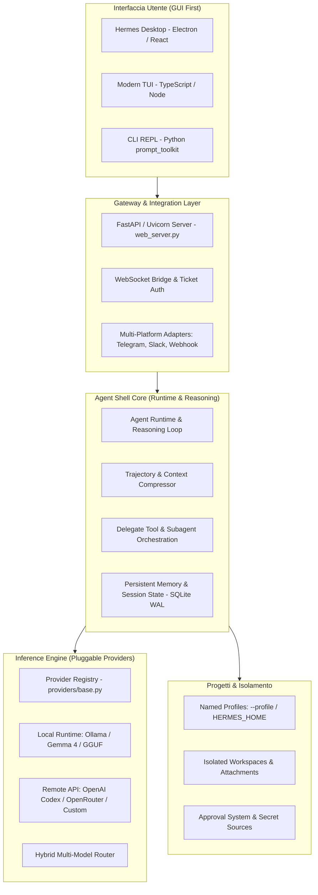

# ARCHITECTURE — NOEMETRA Agent Shell

## 1. Visione d'Insieme

**NOEMETRA Agent Shell** è un involucro applicativo universale, modulare, open-source, multi-modello e multi-agente per la progettazione, configurazione ed esecuzione di sistemi di intelligenza artificiale.

Derivato dal codice sorgente di Hermes Agent (Nous Research), NOEMETRA Agent Shell ne preserva i componenti fondamentali di runtime, orchestrazione e interfaccia, disaccoppiando completamente l'architettura da qualsiasi dipendenza obbligatoria da servizi commerciali proprietari (Nous Portal, modelli imposti, telemetria forzata).

---

## 2. Strati Architetturali

### 2.1 Agent Runtime e Reasoning Loop (`agent/`)
- **Ciclo di esecuzione**: implementato in `agent/agent.py` e `run_agent.py`, gestisce lo scambio conversazionale, la generazione di output e la risoluzione degli schemi di chiamata strumenti (tool calling).
- **Compressione di contesto**: `trajectory_compressor.py` e `agent/agent_init_ollama.py` gestiscono il monitoraggio dinamico delle finestre di contesto (`num_ctx`). Nei modelli locali (Ollama), il sistema rileva la capacità effettiva via `/api/show` e calibra la soglia di compressione per evitare overflow di memoria VRAM o troncamento silenzioso.
- **Guardrails e Sanitizzazione**: `agent/agent_guardrails.py` purifica i messaggi orfani, rimuove duplicati nelle chiamate agli strumenti e applica limiti di sicurezza su chiamate ricorsive.

### 2.2 Sistema di Inferenza Multi-Modello (`providers/`, `plugins/model-providers/`)
- **Registry estensibile**: definita in `providers/base.py` attraverso la classe `ProviderProfile`.
- **Scorporo dei provider**: ogni backend di inferenza vive come plugin autonomo in `plugins/model-providers/<nome>/`.
- **Supporto Locale Nativo**: Ollama è integrato out-of-the-box (`hermes_cli/models_local.py`, `agent/agent_init_ollama.py`), con cache di modelli, probe dinamico e supporto a opzioni custom come `options.num_ctx` e disattivazione del `think` block.
- **Supporto Remoto e Ibrido**: compatibilità nativa con OpenAI Codex, API OpenAI-compatible generiche, OpenRouter, Anthropic, Gemini, DeepSeek e router custom.
- **Scelta per Agente**: sottogruppi di agenti e subagenti possono ricevere runtime e modelli eterogenei nella stessa pipeline.

### 2.3 Orchestrazione e Subagenti (`tools/delegate_tool*.py`)
- **Subagent Architecture**: il tool `delegate_task` istanzia agenti secondari (`AIAgent`) in conversazioni isolate, dotati di proprio ID di task, workspace dedicato e sottoinsieme di strumenti controllati.
- **Isolamento della memoria**: ogni subagente opera con un proprio database di sessione (`state.db`) evitando la corruzione o la condivisione involontaria della cronologia del genitore.
- **Controllo di profondità**: clamp configurabile della profondità di spawn (`max_spawn_depth`) e tracciamento asincrono del ciclo di vita.
- **Rollup dei costi**: consolidamento trasparente dell'utilizzo e dei tempi di esecuzione dal subagente al genitore.

### 2.4 Memoria Persistente e Stato di Sessione (`hermes_state_*.py`)
- **Archiviazione su SQLite WAL**: ogni profilo mantiene `state.db` con `journal_mode=wal`, garantendo consistenza atomica e resistenza a crash di sistema.
- **Gestione sessioni**: resume istantaneo via CLI (`hermes -c`, `hermes --resume <id>`) o tramite interfaccia grafica.
- **Checkpointing**: snapshot del filesystem prima di operazioni distruttive con possibilità di ripristino (`/rollback`).

### 2.5 Gateway e API Server (`gateway/`, `hermes_cli/web_server.py`)
- **FastAPI / Uvicorn**: server HTTP e WebSocket (`web_server.py`) che espone endpoint REST, streaming di risposte e compatibilità con lo standard OpenAI API (`gateway/platforms/api_server_openai_routes.py`).
- **Ticket Authentication**: minting di ticket crittografici per sessioni WebSocket su socket locali sicuri.

### 2.6 Interfaccia Grafica Desktop (`apps/desktop/`)
- **Architettura Electron**: frontend sviluppato in React + Vite (`apps/desktop/src`), processo principale Node.js/TypeScript (`apps/desktop/electron`).
- **Separazione dei processi**: l'applicazione desktop avvia e controlla il backend locale tramite supervisione dei processi (`backend-child.ts`, `backend-connection-state.ts`).
- **Personalizzazione identità**: configurazione centralizzata tramite `apps/desktop/product-identity.cjs`.

---

## 3. Isolamento dei Progetti

Il sistema adotta un modello multi-progetto basato su **Profili Isolati** (`--profile <nome>` o variabile `HERMES_HOME`):
1. **Dati e Memoria**: ciascun profilo ha la propria directory con `config.yaml`, `.env`, database `state.db`, sessioni, cache e allegati.
2. **Credenziali**: le chiavi API o le impostazioni locali di un progetto non sono visibili agli altri profili.
3. **Workspace Dedicato**: cartella di lavoro indipendente con tracciamento file separato.
